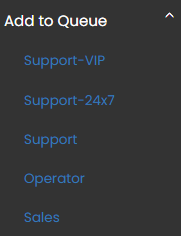

# SwitchBoard Cloud™ docs

Source for [docs.switchboard.cloud](https://docs.switchboard.cloud), built with
[Astro Starlight](https://starlight.astro.build) and deployed to GitHub Pages on every push to `main`
(`.github/workflows/deploy.yml`). Pull requests run the same build without deploying.

## Run it locally

Needs Node 22.23.4 or later.

```sh
npm ci
npm run dev      # http://localhost:4321/docs/
npm run build    # type check + static build into dist/
```

## Where things live

| What | Where |
|---|---|
| Pages | `src/content/docs/docs/<section>/<page>.md` (URL `/docs/<section>/<page>/`) |
| Sidebar order and labels | `sidebar` in `astro.config.mjs` |
| Screenshots | `public/images/docs/<page>/` |
| Brand colours, fonts, screenshot frame | `src/styles/theme.css` |
| Redirects from old URLs | `redirects` in `astro.config.mjs` |

## Writing a page

Each page starts with a title. Starlight shows it as the page heading, so start the body at `##`.

```md
---
title: Queues
---

## Queue configuration


```

- **Images:** plain Markdown, path from `/images/...`, with alt text that says what the screenshot shows.
- **Links between pages:** absolute, with a trailing slash: `[external number](/docs/switchboard/external_numbers/)`.
- **Version notes:** a paragraph that is only `*Available from SwitchBoard 1.22.0.*` renders as a version badge.
- **Notes and warnings:** `:::note` / `:::caution` blocks ([asides](https://starlight.astro.build/guides/authoring-content/#asides)).
- **Tabs and other components:** rename the page to `.mdx` and import from `@astrojs/starlight/components`
  (see `phone_config.mdx`).
- **New page:** add the file, then add it to the `sidebar` in `astro.config.mjs`.
