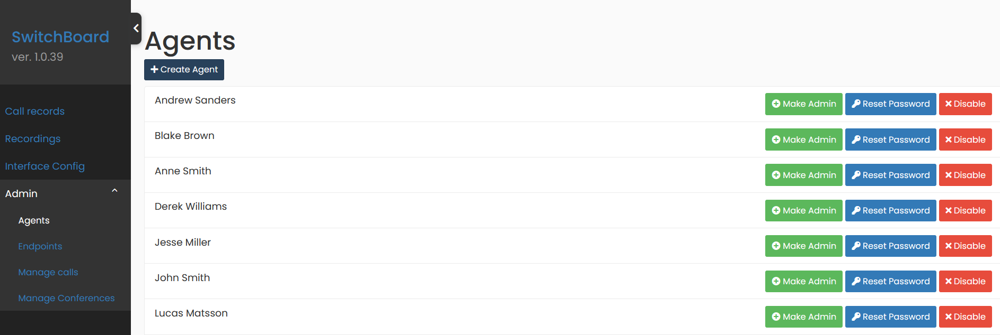
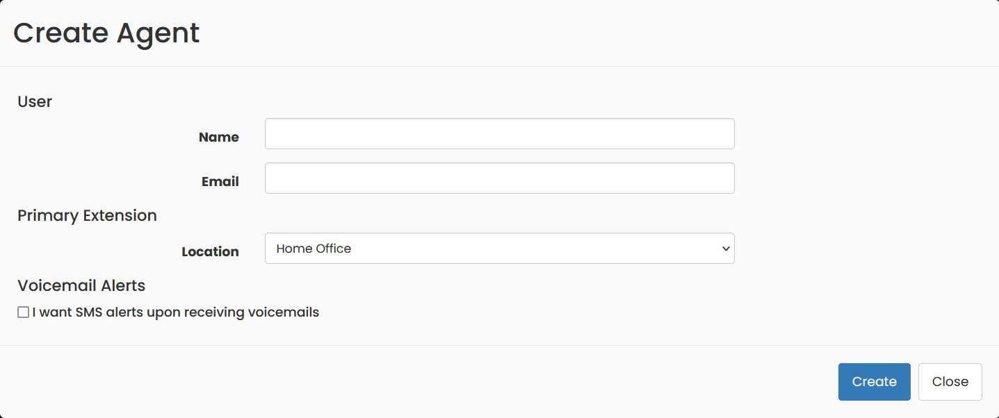
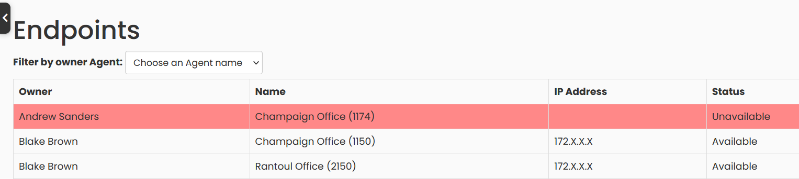
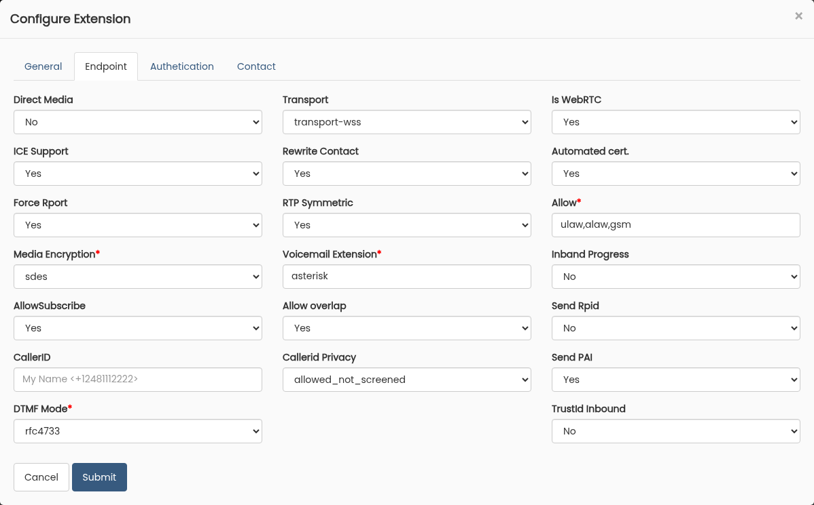
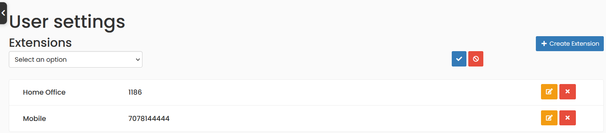
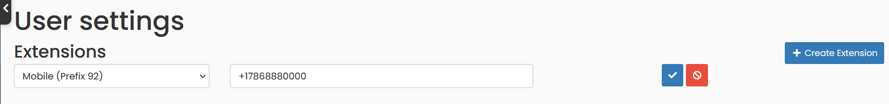
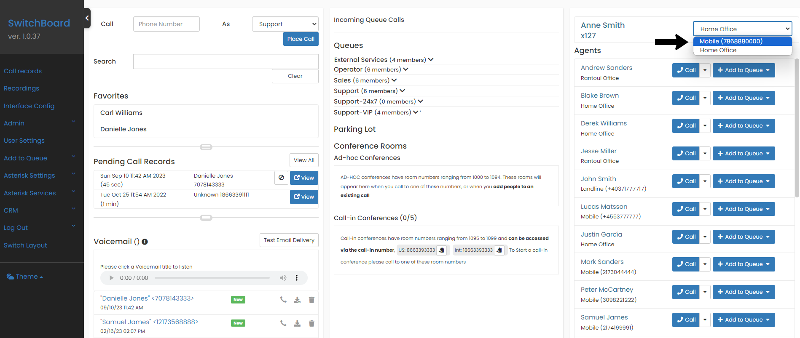

## Agents

Only administrators can manage agents. To create and configure Agents, go to `Settings` -> `Users & Devices` -> `Agents`; in that page you will be able to change the password of an agent, enabling or disabling, among other options.

Use the `Create Agent` button to easily add a new agent. Please note that an agent can have more than one extension assigned, this does not mean that you should create more than one agent for a person.

## View list of Extensions or Endpoints

Go to `Settings` -> `Users & Devices` -> `Extensions`, where you will find a list of all the existing extensions and their current connection status to the telephone system.

## Show the current caller after a transfer (Send PAI)

When a call is transferred, the agent who stays on the call starts talking to someone new. **Switchboard Cloud™** tells that agent's phone who the new person is, so the screen shows their name and number instead of the person who placed the call.

This is on by default for agent extensions. To see or change it, go to `Settings` -> `Users & Devices` -> `Extensions`, click `Edit` on the extension, and open the `Endpoint` tab. `Send PAI` sits next to `Send Rpid`.

* `Yes`: the phone is told when the other person changes. This is the recommended setting.
* `No`: the phone keeps showing the person the call started with. Use it only for a phone that has trouble with the update.
* `None specified`: the same as `No`.

Some phones also need a setting of their own before they show the new name. See [Set Up VoIP Phones](./phone_config#show-who-you-are-talking-to-after-a-transfer).

## Create new Local Extension

To create a new extension to your agent, from which you are logged in, open your account menu at the bottom of the left menu and choose `My Settings`.

## Create new Mobile Extension

You can also use your mobile phone to make and receive calls from the **Switchboard Cloud™** interface. We recommend using a phone connected to the local network, but if you are out of the office one day you can use your cell phone and stay connected to the phone system.

To create a mobile extension go to `My Settings` -> `Create Extension`. Choose Mobile type, with any of the prefixes (but you cannot have more than one mobile extension with the same prefix). Note that the resulting extension number will be = the prefix + agent number.

The system will treat your cell phone as another extension, but internally there are some differences when connecting a call, since it will have an extra channel to connect with your device.

Remember that you can work with your cell phone if you make and answer calls from the **Switchboard Cloud™** Interface (not from your cell phone).

It's important that you tell the application which of your extensions you're currently connected from. To do this, easily configure your Primary extension in the dashboard at the top right, as you can see in the image below.

