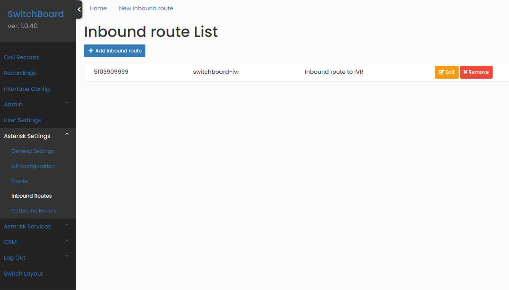
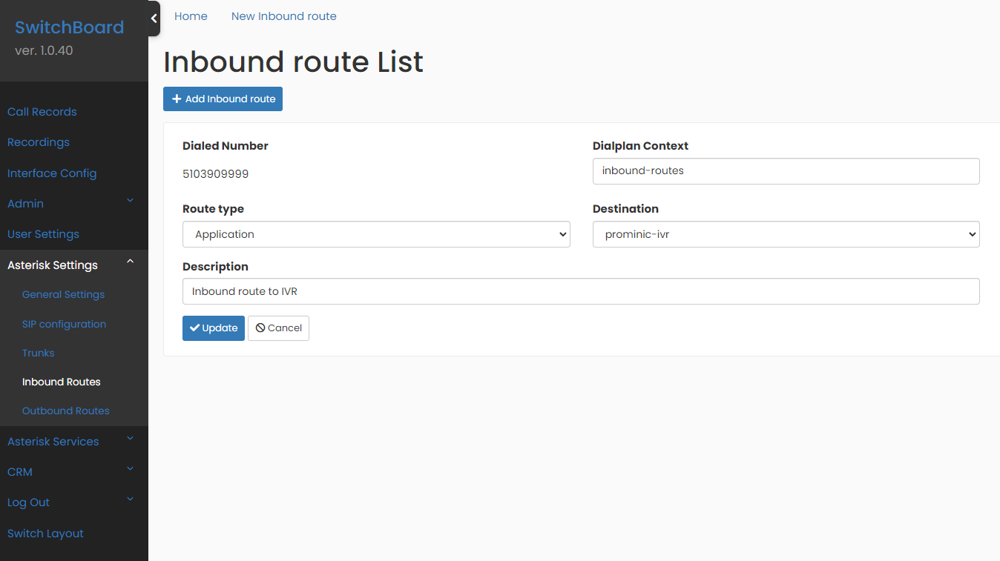
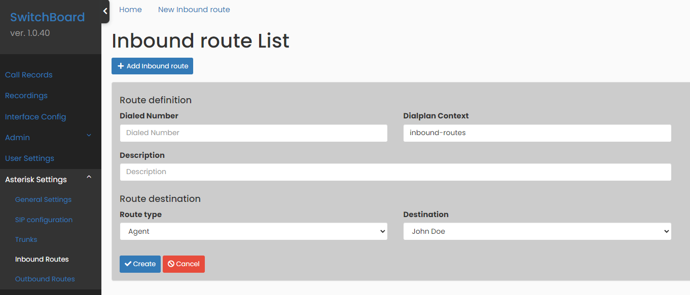
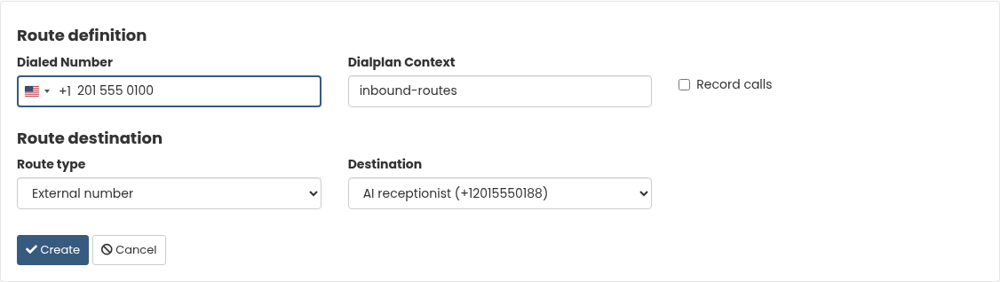

## Inbound Routes

The **Inbound routes** page is available only for administrator users, under `Settings` -> `Phone System` -> `Inbound Routes`. It allows you to configure which destination **Asterisk®** uses for inbound calls from **trunks**.

In this way, in the system you can easily specify what to do when you receive a call to one of your telephone numbers (which you previously purchased from your communication service provider). You can choose to route this call to:

1. An **Agent**.
2. A service **Queue** for your department, such as Sales or Support, where several agents simultaneously receive the call until one of them takes it.
3. Your phone system **IVR**, that "answering machine" that interacts with Users through the use of voice and **DTMF** tones input with a keypad.
4. An **External number**: an outside phone number, such as an answering service or an AI receptionist. See below.

 

## Send a number's calls to an outside number

*Available from SwitchBoard 1.22.0.*

An inbound route can send calls straight to an outside phone number, for example an AI receptionist or an answering service. First add the number under `Settings` -> `Phone System` -> `External Numbers` (see [External Numbers](./../../docs/switchboard/external_numbers)). Then, on the inbound route, set the **Route type** to **External number** and pick it as the **Destination**.

  

