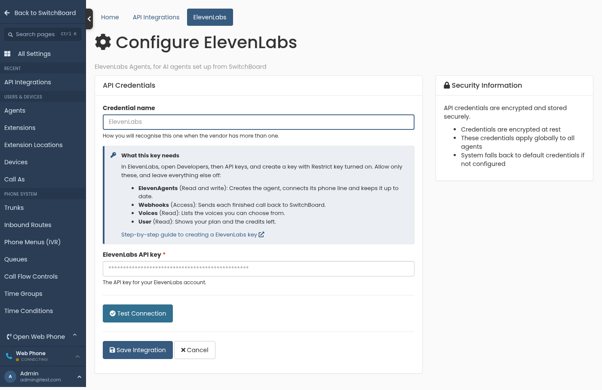
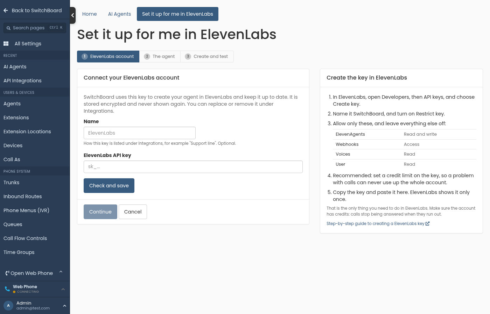

## API Integrations: create the right API key

*Available from SwitchBoard 1.22.0.*

SwitchBoard connects to other services, such as Twilio for calls and OpenAI or Amazon Web Services for transcription and summaries, using an API key that you create in that service. Many services let you choose what a key is allowed to do. A key that is missing a permission is usually accepted when you save it, then fails later, when SwitchBoard first needs that permission.

This page lists, for each service, the kind of key to create and the permissions it needs. SwitchBoard shows the same list beside the key fields, with a link back to the matching section here.

- [Twilio](#twilio)
- [Amazon Web Services](#aws)
- [OpenAI](#openai)
- [Anthropic](#anthropic)
- [ElevenLabs](#elevenlabs)

### Add a key to SwitchBoard

1. Go to **Settings > Integrations > API Integrations**.
2. Click **Connect** next to the service, or **Manage credentials** if it already has a key.
3. Give the key a **Credential name**, so you can tell your keys apart, for example *Production* or *AI agents*.
4. Read **What this key needs**, create the key in the service as described below, and paste it in.
5. Click **Test Connection** if it is offered, then **Save Integration**.

<p align="center">
  
</p>

You can keep several keys for one service. The one marked **Default for this vendor** is used unless a feature has been set to use a different one. Use **Make default** to change it.

### Twilio

SwitchBoard uses Twilio for phone numbers, calls and text messages.

**Key type: Standard.** Standard keys have no permission settings. A Standard key can do everything SwitchBoard needs and cannot manage your account or other keys, which makes it the safest choice.

1. Sign in to the [Twilio Console](https://console.twilio.com).
2. Open **Account**, then **API keys & tokens**, and click **Create API key**.
3. Give it a name, for example *SwitchBoard*, and choose the **Standard** key type.
4. Copy the **SID** and the **Secret**. Twilio shows the secret only once.
5. In SwitchBoard, enter your **Account SID** (from the Twilio Console home page, it starts with `AC`), the key **SID** (it starts with `SK`) and the **Secret**.

SwitchBoard has not been tested with Twilio's Restricted keys, so use a Standard key.

<a id="aws"></a>
### Amazon Web Services

SwitchBoard can use Amazon Polly to read text aloud, Amazon Transcribe to turn recordings into text, Amazon Bedrock for call summaries and Amazon Comprehend for call sentiment.

**Key type: an access key for an IAM user** whose policy allows the actions below. You only need the parts for the services you use.

| Service | Actions | What SwitchBoard uses it for |
|---|---|---|
| Amazon Polly | `polly:SynthesizeSpeech`, `polly:DescribeVoices` | Reading text aloud, for example greetings and announcements |
| Amazon Transcribe | `transcribe:StartTranscriptionJob`, `transcribe:GetTranscriptionJob` | Turning recordings into text |
| Amazon S3 | `s3:PutObject`, `s3:GetObject`, `s3:ListBucket`, `s3:CreateBucket` | Holding a recording in your transcription bucket while Transcribe works on it |
| Amazon Bedrock | `bedrock:InvokeModel` | Writing call summaries |
| Amazon Comprehend | `comprehend:DetectSentiment` | Rating the sentiment of a call |

1. If you will transcribe with Amazon Transcribe, open **S3** in the AWS console and create a bucket for SwitchBoard, in the same region you will choose in step 7. Bucket names are shared by every AWS account, so pick one that is yours, for example *acme-switchboard-transcripts*.
2. Open **IAM**. Under **Policies**, click **Create policy**, open the **JSON** tab and paste the policy below. Replace `YOUR-BUCKET` with your bucket name, or remove the two bucket sections if you do not use Amazon Transcribe.
3. Name the policy, for example *SwitchBoard*, and create it.
4. Under **Users**, create a user, for example *switchboard*, and attach the policy to it. It does not need console access.
5. Open the user, go to **Security credentials**, and click **Create access key**. Choose **Application running outside AWS**.
6. Copy the **Access key ID** and the **Secret access key**. AWS shows the secret only once.
7. In SwitchBoard, paste both and choose the **Region** where you use these services.
8. If you created a bucket in step 1, tell SwitchBoard its name: go to **Settings > AI > AI Providers**, click the edit (pencil) button on the AWS provider that transcribes, open **Advanced settings**, and enter this in **Advanced options (JSON)**, with your bucket name:

   ```json
   {"s3Bucket": "acme-switchboard-transcripts"}
   ```

   Without it, SwitchBoard looks for a bucket with a default name that your account cannot own, and transcriptions fail.

```json
{
  "Version": "2012-10-17",
  "Statement": [
    {
      "Sid": "ReadTextAloud",
      "Effect": "Allow",
      "Action": ["polly:SynthesizeSpeech", "polly:DescribeVoices"],
      "Resource": "*"
    },
    {
      "Sid": "Transcribe",
      "Effect": "Allow",
      "Action": ["transcribe:StartTranscriptionJob", "transcribe:GetTranscriptionJob"],
      "Resource": "*"
    },
    {
      "Sid": "TranscriptionBucket",
      "Effect": "Allow",
      "Action": ["s3:ListBucket", "s3:CreateBucket"],
      "Resource": "arn:aws:s3:::YOUR-BUCKET"
    },
    {
      "Sid": "TranscriptionFiles",
      "Effect": "Allow",
      "Action": ["s3:PutObject", "s3:GetObject"],
      "Resource": "arn:aws:s3:::YOUR-BUCKET/*"
    },
    {
      "Sid": "Summaries",
      "Effect": "Allow",
      "Action": ["bedrock:InvokeModel"],
      "Resource": "*"
    },
    {
      "Sid": "Sentiment",
      "Effect": "Allow",
      "Action": ["comprehend:DetectSentiment"],
      "Resource": "*"
    }
  ]
}
```

For summaries, the Bedrock model chosen under **Settings > AI > AI Providers** must be offered in that region. Amazon Bedrock turns a model on for your account the first time it is used, and that first use needs more than this policy allows: for models sold through AWS Marketplace, such as Anthropic's, it needs `aws-marketplace:Subscribe` and `aws-marketplace:ViewSubscriptions`, and Anthropic models also ask for a one-time use case form. The simplest way is for an AWS administrator to open the model once in the Amazon Bedrock console playground. After that, the key above is enough.

### OpenAI

SwitchBoard can use OpenAI to transcribe recordings, write summaries and run AI agents on GPT-Live.

**Key type: a project key.** Create it in the OpenAI project that should be billed. A key with **All** permissions works. If you choose **Restricted**, allow:

| Permission | Access | What SwitchBoard uses it for |
|---|---|---|
| List models | Read | Checking that the key works |
| Model capabilities | Request | Transcribing recordings, writing summaries, and running AI agent calls on GPT-Live |
| Webhooks | Write | Only for AI agents on GPT-Live: OpenAI tells SwitchBoard when a call arrives |

1. Sign in at [platform.openai.com](https://platform.openai.com) and choose the project from the project menu.
2. Open **Settings**, then **API keys**, and click **Create new secret key**.
3. Give it a name, for example *SwitchBoard*, and choose **All** or **Restricted**. For Restricted, set the permissions in the table above and leave the rest at **None**.
4. Copy the key. OpenAI shows it only once.
5. For AI agents on GPT-Live, also copy the **Project ID** from the project's settings. It starts with `proj_`.
6. In SwitchBoard, paste the key, and the project ID if asked.

If OpenAI refuses requests with a "missing scopes" error, open the key and check that **Model capabilities** is set to **Request**. Set the **Model capabilities** row itself, not only some of the sub-items under it.

### Anthropic

SwitchBoard can use Anthropic's Claude models for call summaries and answers.

**Key type: any API key.** Anthropic keys have no permission settings. Each key belongs to a workspace, and its usage is billed to that workspace.

1. Sign in to the [Anthropic Console](https://console.anthropic.com).
2. Open **Settings**, then **API keys**, and click **Create key**.
3. Choose the workspace, give the key a name, for example *SwitchBoard*, and create it.
4. Copy the key. Anthropic shows it only once.
5. In SwitchBoard, paste the key.

### ElevenLabs

SwitchBoard uses ElevenLabs to set up and run AI agents that answer calls.

**Key type: a restricted key** with only these permissions turned on:

| Permission | Access | What SwitchBoard uses it for |
|---|---|---|
| ElevenAgents | Read and write | Creating the agent, connecting its phone line and keeping it up to date |
| Webhooks | Access | Sending each finished call back to SwitchBoard |
| Voices | Read | Listing the voices you can choose from |
| User | Read | Showing your plan and the credits left |

1. Sign in to [ElevenLabs](https://elevenlabs.io/app) and open **Developers**, then **API keys**.
2. Click **Create key**, name it *SwitchBoard*, and turn on **Restrict key**.
3. Turn on the four permissions above, at the access shown, and leave everything else off.
4. Recommended: set a credit limit on the key, so a problem with calls can never use up the whole account.
5. If you restrict the key to IP addresses, include your SwitchBoard's address. The AI agent setup screen shows it.
6. Copy the key. ElevenLabs shows it only once.
7. In SwitchBoard, paste the key under **API Integrations**, or while setting up an AI agent under **Settings > AI > AI Agents**.

When you set up an AI agent, SwitchBoard checks each permission and tells you which one is missing.

<p align="center">
  
</p>

### If a key stops working

- **The key was refused.** Check that you copied all of it. Keys are shown only once, so if in doubt, create a new key and replace the old one.
- **A feature fails but the key was accepted.** Compare the key's permissions with the list for that service above. If the service lets you edit the key, add the missing permission there and nothing changes in SwitchBoard. Otherwise create a new key and replace the old one.
- **Replacing a key.** Click **Edit** next to the key under **API Integrations**, paste the new key and save. Features that use it switch over straight away.
