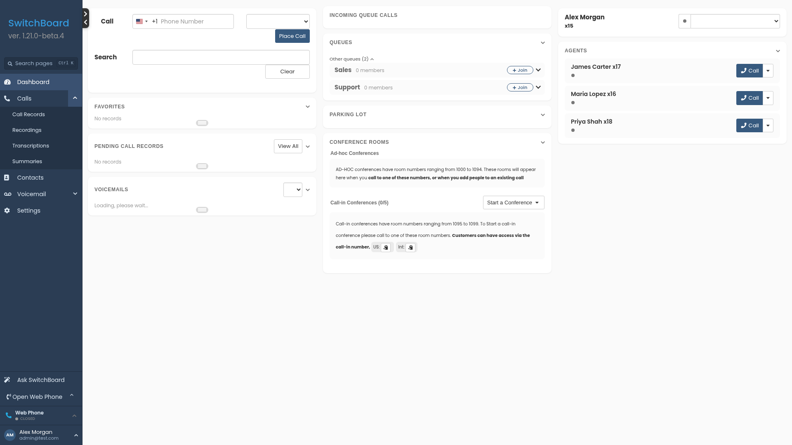
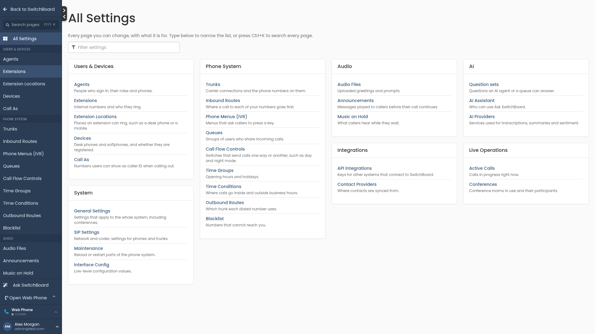
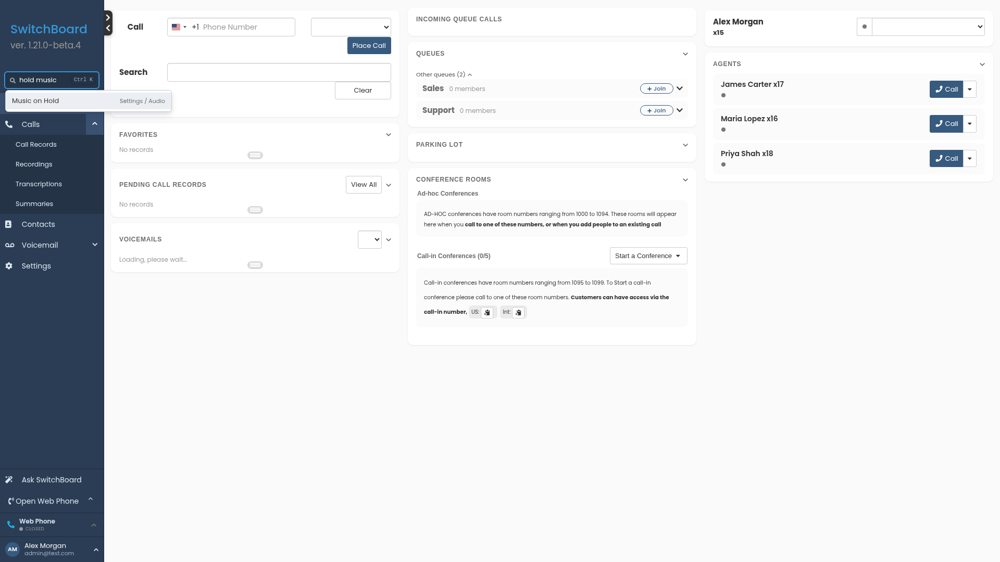

## Finding your way around

*Available from SwitchBoard 1.21.0.*

The left menu has two parts: a short menu for everyday work, and a separate **Settings** area for configuring your phone system. You only see the pages your role allows.

  

### The everyday menu

- **Dashboard**: your calls, queues, agents and voicemail at a glance.
- **Calls**: Call Records, Recordings, Transcriptions, Summaries, Note Taker and AI Agent Calls (when these are switched on).
- **Messages**: text and WhatsApp conversations, when messaging is set up.
- **Contacts**.
- **Voicemail**: your mailboxes and voicemail notes.
- **Settings**: opens the Settings area (see below).

Clicking a group name, such as **Calls**, opens its first page. Click the small arrow next to it to show or hide the other pages in the group. SwitchBoard remembers which groups you keep open.

### The Settings area

**Settings** replaces the menu with the configuration pages, grouped by topic:

| Group | Pages include |
|---|---|
| Users & Devices | Agents, Extensions, Extension Locations, Devices, Call as |
| Phone System | Trunks, Inbound Routes, Phone Menus (IVR), Queues, Call Flow Controls, Time Groups, Time Conditions, Outbound Routes, Blacklist |
| Audio | Audio Files, Announcements, Music on Hold |
| Messaging | Messaging Setup |
| AI | AI Agents, Question sets, AI Assistant, AI Providers |
| Integrations | API Integrations, Contact Providers |
| Live Operations | Active Calls, Conferences, Line Monitoring |
| System | General Settings, SIP Settings, Maintenance, Interface Config |

At the top of the Settings area:

- **Back to SwitchBoard** returns to the everyday menu.
- **All Settings** lists every settings page you can open, each with a one-line description. Type in its filter box to narrow the list.
- **Recent** shows the last three settings pages you opened.

  

### Find any page: Ctrl+K

Press **Ctrl+K** (**Cmd+K** on a Mac), or click the search box at the top of the menu, and type part of a page's name. Search also knows older names and common words, so `asterisk` finds **Maintenance** and `hold music` finds **Music on Hold**. Use the arrow keys and press **Enter** to open a result.

  

### Your account menu

Your name at the bottom of the menu opens your account menu:

- **My Settings**: your display name, language, extensions and security settings.
- **Assistant history**: your questions to Ask SwitchBoard, when it is available to you (see [Ask SwitchBoard](./ask_switchboard)).
- **Theme**: Light, Dark or Automatic (follows your computer's setting).
- **Send Feedback**.
- **Log Off**, **Log Off and Leave All Queues**, or **Log Off and Switch to Mobile**.

### Joining a queue

On the **Dashboard**, the **Queues** panel lists your queues first, each marked **Active** or **Paused**. Open **Other queues** and click **+ Join** to add yourself to another queue. See [Queues](./queues).
