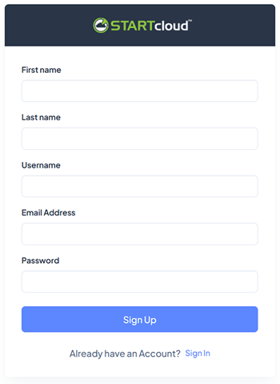
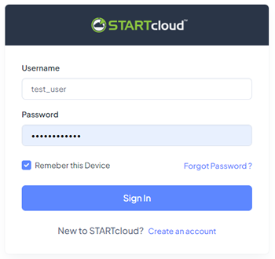
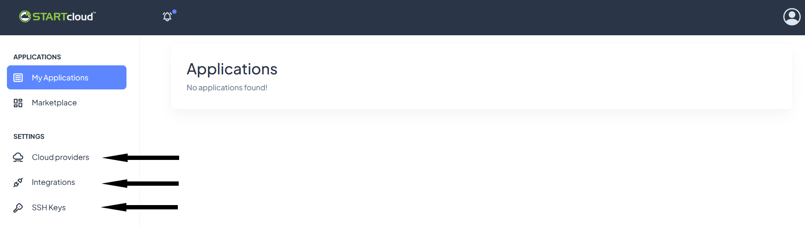

## Sign Up to STARTcloud™

Sign Up to the **STARTcloud™** platform by following this [link](http://startcloud.com/registration).

## Log in to STARTcloud™

Once you are registered, [log in](http://startcloud.com/login). You can follow the link on the same page `Already have an Account? Sign In`.

## First Steps

Before creating your first **Switchboard Cloud™** Instance, go to the `Settings` section and create at least one **Cloud Provider**, an **SSH Key** and the minimum **Integrations** necessary to launch your new instance.

