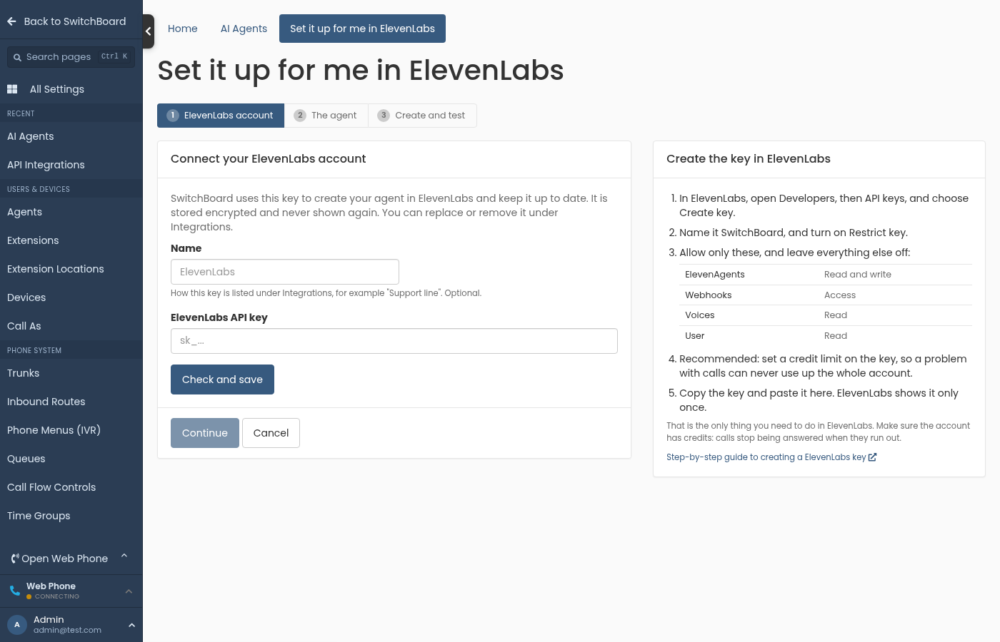

*Available from SwitchBoard 1.20.0.*

An **AI agent** is a voice assistant that answers calls on its own extension. It can take a message after hours, collect the details of a support request when the queue is busy, or ask the first questions of an emergency call. When the call ends, SwitchBoard files what the agent collected with the call, and emails it to the people you choose.

The conversation runs at an AI voice provider, **ElevenLabs** or **OpenAI GPT-Live**, on your own account with that provider. SwitchBoard decides which calls reach the agent, tells it who is calling, and sends the call somewhere else if the agent cannot take it.

:::note
AI agents are switched on per phone system. If you don't see **AI Agents** under **Settings > AI**, ask your SwitchBoard contact to enable them. OpenAI GPT-Live is also switched on separately, on request.
:::

## Choose how to set up the agent

Go to **Settings > AI > AI Agents** and click **New AI Agent**. There are three options:

- **Set it up for me** (recommended): describe the agent in SwitchBoard, and SwitchBoard sets it up at the provider, connects your phone line and keeps it up to date when you make changes. All you need from the provider is an API key. Choose **ElevenLabs** or **OpenAI GPT-Live**.
- **Connect an agent you already built**: for an agent you already run at ElevenLabs, Vapi or another provider, and keep managing there. You copy a few settings across by hand.
- **Build an AI agent here** is not available yet.

## Set it up for me with ElevenLabs

The agent is created in your ElevenLabs account and runs there. Calls use your ElevenLabs credits.

### 1. Connect your ElevenLabs account

1. Create an API key in ElevenLabs with **Restrict key** turned on and only these permissions: **ElevenAgents** Write, **Webhooks** Access, **Voices** Read and **User** Access. The [ElevenLabs key guide](/docs/switchboard/integrations/#elevenlabs) has each step.
2. If you limit the key to IP addresses, include your SwitchBoard's address. The setup screen shows it.
3. Paste the key, give it a name if you like (for example *Support line*), and click **Check key**. SwitchBoard lists what the key can do and shows your plan and the credits left.

If you already saved an ElevenLabs key, choose it under **Use a saved key**. Keys are stored, encrypted, under **Settings > Integrations > API Integrations**, and each agent keeps the key it was set up with. Adding a new key never replaces the key another agent uses.

:::caution
When the account runs out of credits, ElevenLabs stops answering and calls go to the agent's fallback. If you set a credit limit on the key, calls also stop when the key reaches it, even with account credits left. SwitchBoard shows a warning when credits run low.
:::

### 2. Describe the agent

- **Template**: fills in the greeting, instructions and answers to collect for a common case, such as *Support queue fallback* or *Emergency intake*. Choose *None, I'll add my own* to start empty. You can change everything afterwards.
- **Name** and **Extension**: the extension is what staff dial to reach the agent, by convention 9100 upwards.
- **Greeting**: the first thing the caller hears.
- **Instructions (system prompt)**: how the agent behaves, its role, its tone and when to end the call. Leave **Add these lines to the instructions** ticked to keep the agent to the purpose of the call, have it ask for the answers to collect and hang up after saying goodbye.
- **Voice** and **Language** (English or Spanish). The voice list includes any voices you added in ElevenLabs.
- **Let the agent end the call when it is done**: turned off, the call only ends when the caller hangs up.
- **Questions**: the answers the agent asks for. See [Choose what the agent collects](#choose-what-the-agent-collects).
- **If the agent cannot take the call**: required. Choose a queue, a voicemail box, or a phone number or extension. Calls go there when ElevenLabs is unreachable, refuses the call or ends it before a conversation starts.
- **Email the details to**: one or more addresses, separated by commas. Each gets the answers, a summary and the transcript as soon as the call is finished.

Click **Create the agent**.

### 3. Let SwitchBoard finish the setup

SwitchBoard runs four steps and ticks each one off:

1. **Connect call results to SwitchBoard**: each finished call is sent back to SwitchBoard, signed.
2. **Create the agent** in your ElevenLabs account.
3. **Connect your phone line**, secured so the agent only accepts calls from your SwitchBoard.
4. **Route calls to the agent**, so it can be dialled and used in queues, phone menus and inbound routes.

If a step fails, the message says why, for example a missing key permission or no credits left. Fix it and click **Retry**: the steps already done are kept. An agent marked **Setup incomplete** in the list doesn't receive calls yet; open it and click **Continue setup**.

### Change the agent later

Open the agent from **Settings > AI > AI Agents** and click **Edit greeting and instructions**. Saving updates the agent in ElevenLabs straight away. SwitchBoard only changes what it set up: the AI model, knowledge base, tools and advanced voice settings stay yours to change in ElevenLabs, and SwitchBoard never overwrites them.

## Set it up for me with OpenAI GPT-Live

*Available from SwitchBoard 1.21.0.*

The agent runs on OpenAI's real-time voice model with your OpenAI account. Nothing about the agent is stored at OpenAI: SwitchBoard sends its settings when each call starts, so a change applies from the next call. Calls are billed to your OpenAI project.

### 1. Connect your OpenAI project

1. At [platform.openai.com](https://platform.openai.com), open the project the agent should run in.
2. Make sure GPT-Live phone calls are turned on for that project. If they are not, OpenAI refuses every call and callers go to the agent's fallback.
3. Create an API key in the project with **All** permissions. A Restricted key cannot be given access to webhooks, which SwitchBoard needs to be told when a call arrives. The [OpenAI key guide](/docs/switchboard/integrations/#openai) has each step.
4. Copy the **Project ID** from the project's settings. It starts with `proj_`.
5. Paste the key and the project ID, then check them. SwitchBoard confirms that OpenAI accepts the key, that the project ID is valid, and that the key can read webhooks. Whether phone calls are on for the project is only confirmed by the first call.

### 2. Describe the agent

The same settings as for ElevenLabs (template, name, extension, greeting, instructions, questions, fallback and email), with two more under **How the agent thinks**:

- **Reasoning model**: GPT-Live listens and speaks, and this model decides what to say. *GPT-6 Luna* is the fastest and lowest cost. *GPT-6 Sol* handles harder conversations, but answers more slowly and costs more.
- **Reasoning effort**: more effort means fewer mistakes but longer pauses before the agent answers. *Low* suits most calls.

The **Voice** list has GPT-Live's built-in voices. The voice cannot change during a call.

### 3. Let SwitchBoard finish the setup

SwitchBoard creates one webhook in your OpenAI project, so OpenAI tells SwitchBoard each time a call arrives (it is shared by every agent on the same key), then sets up the agent's extension. If a step fails, fix what the message says and click **Retry**.

## Connect an agent you already built

Use this when you build and manage the agent at your provider. SwitchBoard routes calls to it and files what comes back, but changes to the greeting, instructions or voice are made at the provider.

1. On **The agent** step:
   - enter the **Name** and **Extension**, and choose the **Provider** (or **Another provider (SIP)**);
   - **Where do we send the call**: paste the SIP address your provider gives the agent;
   - **Start with**: a template for the questions the agent asks;
   - **If the agent does not answer**: required. A queue, a voicemail box, or a phone number or extension. Point it at whatever happens to these calls today, so an outage at the provider falls back to how things work now;
   - **Email the details to**: the addresses that get the answers and the transcript of each call.
2. The **Set up your provider** step shows the settings to copy across, with steps for the provider you chose:
   - **Secure the connection**: enter the username, password and allowed source address in your provider's inbound settings, so it only accepts calls from your SwitchBoard.
   - **Send call records back to**: set this address as the agent's post-call webhook, and paste the **Signing secret** the provider shows into SwitchBoard. The email, transcript and call record all arrive this way.
   - **Questions**: add these as data collection fields on your agent, spelled exactly as shown.
3. Under **What we will tell your agent**, tick the caller details to send with each call, such as the caller's name. Each one is a choice, because those details leave your SwitchBoard. The agent only uses them if its prompt or greeting refers to them by the name shown, for example *Hi {{sip_sb_caller_name}}, thanks for calling*.

## Choose what the agent collects

*Available from SwitchBoard 1.21.0.*

An agent asks for the questions in its **question set**: for example the caller's name, a callback number and the reason for the call. On the agent's page, choose a set and click **Use this set**, or create **A new set for this agent**. A set can be shared with queues and other agents, so changing it once updates them all. See [Answers and Question Sets](/docs/switchboard/question_sets/).

A question marked **Required** must be answered for the call to count as complete.

## Try the agent, then send calls to it

Dial the agent's extension from your web phone or any SwitchBoard phone and have a test conversation before real callers reach it.

An agent can then be picked as the destination of:

- an [inbound route](/docs/switchboard/inbound_routes/), to answer a number directly;
- a [queue](/docs/switchboard/queues/)'s failover, to take calls nobody answered in time;
- a phone menu (IVR) option or fallback;
- a time condition, a call flow control or an announcement, for example to answer only after hours;
- a Caller Verification outcome, or where blocked callers go.

:::caution
Changing an agent's extension does not update the routes, queues and menus that send calls to it. Point them at the agent again after changing it.
:::

## See the calls an agent answered

Every user can open **Calls > AI Agent Calls**. Each call shows the caller, the time, whether all required answers were collected (**Incomplete** when not), the answers and the transcript, with the agent's and caller's lines marked. Choose an agent to see only its calls. Calls of a deleted agent stay listed, labelled **Deleted**.

The agent's name also appears in the **Agent** column of [Call Records](/docs/switchboard/call_records/), and in its CSV export. A call that went to the agent's fallback is not named after the agent.

On an agent's page, the provider settings choose what is saved on the call record. These apply to every agent on that provider:

- **Transcript**: the provider's transcript, which costs nothing, or SwitchBoard transcribes the recording with your own transcription engine.
- **Summary** and **Answers**: the provider's, or SwitchBoard's from your AI engines. SwitchBoard's answers need automatic answer extraction to be on, and the email then waits up to 10 minutes for them.

## Delete an agent

Open the agent and click **Delete**.

- **Refused while anything still sends calls to it.** The dialog lists each inbound route, queue, menu or other setting that does, with a link. Send them somewhere else first.
- **An agent set up for you at ElevenLabs** is also removed there: the agent, its phone number and its webhook. Nothing else in the account is touched. If ElevenLabs refuses, the agent is kept and you can **Try again**, or **Delete here anyway** and remove what is left in ElevenLabs yourself.
- **A connected agent** is only removed from SwitchBoard. Delete it at the provider if you no longer need it.

The calls it already answered stay listed under **AI Agent Calls**.
