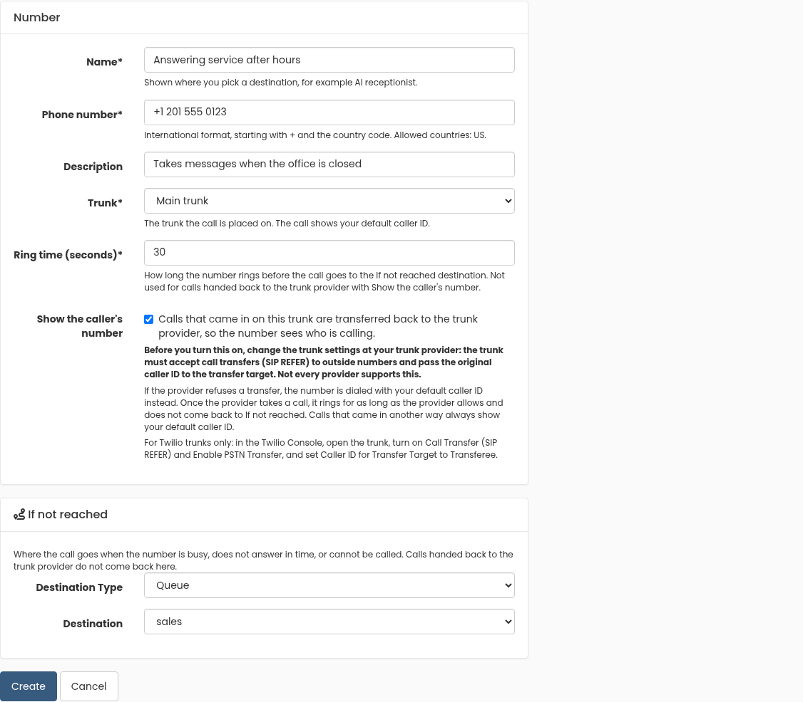
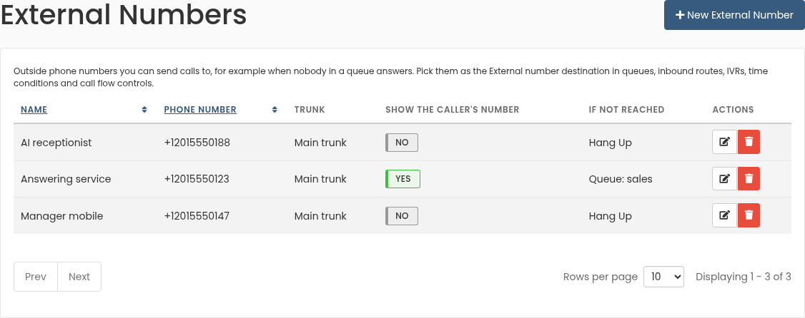

*Available from SwitchBoard 1.22.0.*

An external number is an outside phone number that SwitchBoard can send a call to. Once you add one, you can pick it wherever you choose where a call goes, just like a queue or a phone menu. For example:

- an **AI receptionist** service that answers on its own phone number;
- an **answering service** that takes messages after hours;
- a **manager's mobile**, as the last stop when nobody in a queue answers.

> External numbers are switched on per phone system and are off until they are turned on. If you don't see **External Numbers** under `Settings` -> `Phone System`, ask your SwitchBoard contact to enable them.

Only administrators can add, change or delete external numbers.

### Add an external number

1. Go to `Settings` -> `Phone System` -> `External Numbers` and click **New External Number**.
2. Fill in the form:
   - **Name**: what you will see when you pick a destination, for example *AI receptionist*. Each name must be unique.
   - **Phone number**: in international format, starting with `+` and the country code, for example `+12015550123`. Spaces and dashes are fine; SwitchBoard removes them when you save.
   - **Description** (optional): a note for other administrators.
   - **Trunk**: the trunk the call is placed on.
   - **Ring time (seconds)**: how long the number rings before the call moves on to the **If not reached** destination. The default is 30 seconds; you can set 5 to 300.
   - **Show the caller's number**: see [Let the outside number see who is calling](#let-the-outside-number-see-who-is-calling) below. Leave it off unless your trunk provider is set up for it.
3. Under **If not reached**, choose where the call goes if the number is busy, does not answer within the ring time, or cannot be called. You can pick an agent, a queue, a phone menu, a voicemail box, an announcement, a call flow control or a time condition. Leave it on **Hang Up** to end the call.
4. Click **Create**.

Your external numbers are listed on the same page, with their trunk, whether they show the caller's number, and where calls go if the number is not reached.

### Send calls to an external number

Each external number appears as **External number** in the destination lists, shown with its name and phone number. You can pick it as:

- a queue's **Failover Destination**, for when nobody in the queue answers (see [Queues](/docs/switchboard/queues/));
- the destination of an [inbound route](/docs/switchboard/inbound_routes/);
- an option, or the fallback, of a phone menu (IVR);
- a destination of a time condition or a call flow control;
- where an announcement sends the call after it plays.

Follow Me does not offer external numbers. To ring an outside number from Follow Me, use a remote extension instead.

### What the outside number sees

By default, the external number sees your phone system's default caller ID, not the caller's number. Trunk providers only let you show numbers you own, so this is the number SwitchBoard can always use. You set it as the **Default CallerID Number** under `Settings` -> `System` -> `General Settings`.

### Let the outside number see who is calling

An AI receptionist or an answering service is often more useful when it can see the original caller's number. **Show the caller's number** does this: a call that came in on the external number's trunk is handed back to the trunk provider, which connects it to the outside number and passes on the caller's number.

Before you turn it on, change the trunk's settings **at your trunk provider**. The trunk must accept call transfers to outside numbers and pass the original caller ID to the number the call is transferred to. Not every provider supports this.

For a **Twilio** trunk, open the trunk in the Twilio Console and:

1. Turn on **Call Transfer (SIP REFER)**.
2. Turn on **Enable PSTN Transfer**.
3. Set **Caller ID for Transfer Target** to **Transferee**.
4. Save the trunk.

The form in SwitchBoard repeats these steps under the setting.

Things to know about this setting:

- It only applies to calls that came in on the same trunk as the external number. Other calls, such as calls from an agent's extension or calls that came in on another trunk, are dialed as usual and show your default caller ID.
- If the provider refuses the transfer, SwitchBoard dials the number itself with your default caller ID, so the call still goes through.
- Once the provider takes the call, SwitchBoard is no longer part of it. The ring time and the **If not reached** destination no longer apply, and SwitchBoard does not record the call.
- The trunk needs a host name for this setting to be saved.

### Which numbers are allowed

Calls to an external number are billed to your trunk account, so SwitchBoard checks each number when you save it:

- **Allowed countries.** The number must be in a country your phone system allows. By default, that is the country of your default caller ID. The form shows the allowed countries under the phone number. To allow other countries, ask your SwitchBoard contact.
- **Number types.** Landline, mobile, toll-free and internet phone numbers are allowed. Premium-rate, shared-cost and personal numbers are refused.

Some countries share a country code with others: `+1`, for example, covers the United States, Canada and many Caribbean countries, each a separate country for this check. A number in a country that is not allowed is refused with a message that names its country.

Your trunk provider's own limits, such as Twilio's geographic permissions, still apply.

### Calls cannot loop forever

An external number's **If not reached** destination can lead to another external number, or back to a queue that fails over to the same number. To stop a call from going round and round, one call can pass through at most **three** external numbers. After that, the call ends.

### See which calls were forwarded

Calls sent to an external number are marked in [Call Records](/docs/switchboard/call_records/), with the external number they went to.

### Change or delete an external number

Click the edit button next to a number to change it. Destinations point at the external number itself, not at its name, so you can rename it without updating them.

Before you delete an external number, change every destination that uses it. Calls sent to a deleted external number are hung up.

You cannot delete a trunk while external numbers use it. Move them to another trunk first.
