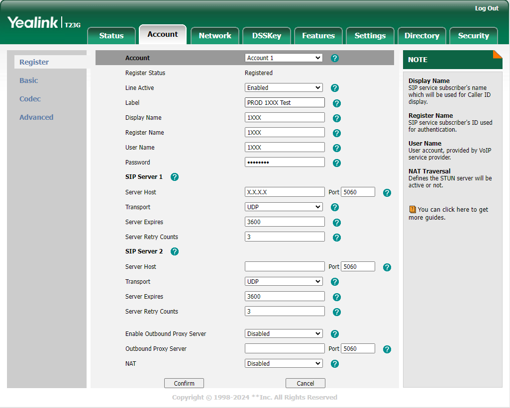
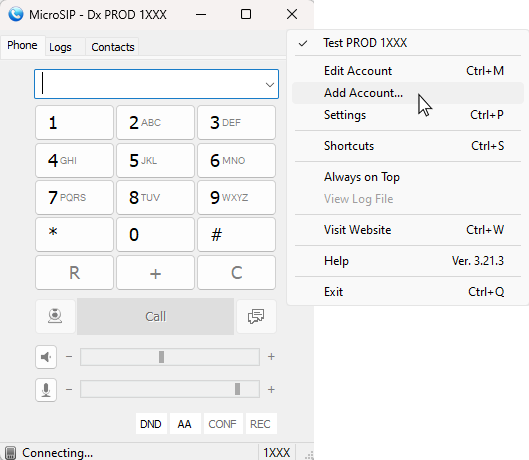
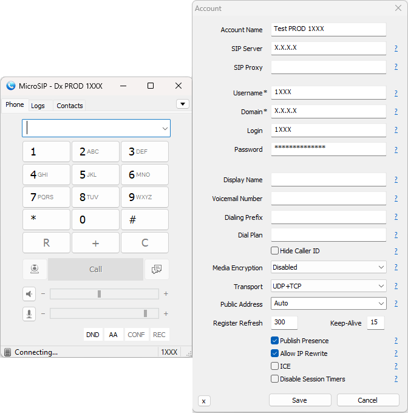
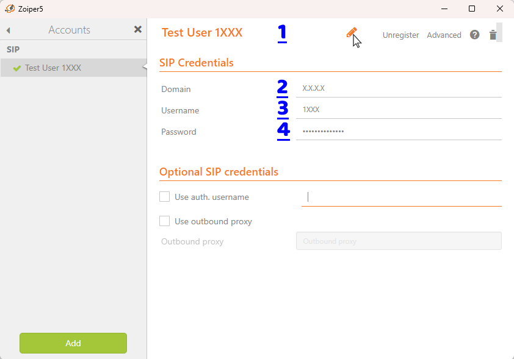
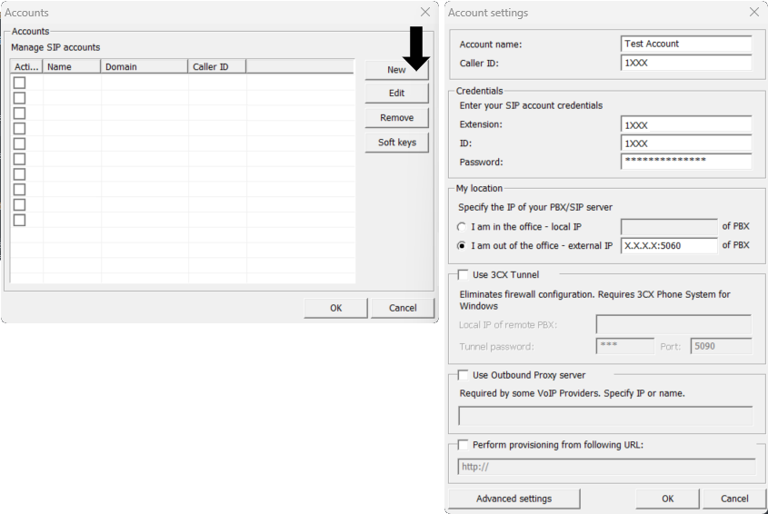

import { Tabs, TabItem } from '@astrojs/starlight/components';

## Set Up your VoIP Phone

Connect your VoIP phone to the network. We recommend working with [**Yealink TX Series Phones**](https://www.yealink.com/en/product-list/ip-phone?filter=t3). More on how to connect your phone [here](https://support-cdn.yealink.com/attachment/upload/attachment/2016-7-8/3/73b4c514-dd7e-4677-a2df-b52d12699bd9/Yealink_SIP-T27G_Quick_Start_Guide_V80_1.pdf).

Once connected, *from the phone* go to `Menu` -> `Status` and check the IPv4 address given to your phone.

Use that IP address to access the phone's configuration page from your browser. Get a detailed guide on how to access this page [here](https://www.3cx.com/sip-phones/manually-configure-yealink-t32g-t38g-t42g-t46g/).

Go to the Account tab and use the following image as a reference to configure your VoIP phone.

* The `Display Name`, `Register Name` and `User Name` are the extension number, which you previously configured for your agent in the **Switchboard Cloud™** Interface.

* The Password is the one stored in the `ps_auths` DB table, for your extension.

* The Server host is the IP address where your **Asterisk®** service is installed. In this example we use a local IP address, ideal for the case in which your VoIP phone is connected to your company's local network, normally via a wired network connection.

### Show who you are talking to after a transfer

When someone transfers a call to you, your phone shows the person you are now talking to.

When you are the one who stays on the call while it is transferred, the person on the other end changes during the call. **Switchboard Cloud™** sends your phone the new person's name and number, but most phones only show them once they are set to:

* **Yealink**: on the phone's configuration page, go to `Account` -> `Advanced`, set `Caller ID Source` to `PAI-FROM`, and click `Confirm`. With the default, `FROM`, the phone keeps showing the person the call started with.
* **Microsip**: keeps showing the person the call started with, and has no setting to change this. The call itself is not affected.
* **Switchboard Cloud™ Web Phone**: updates on its own.

If a phone has trouble with this update, an administrator can turn it off for that extension with the `Send PAI` setting. See [Extensions](/docs/switchboard/extensions/#show-the-current-caller-after-a-transfer-send-pai).

## Set Up a Soft Phone

You can choose between the different brands of Softphones available on the market.

<Tabs syncKey="softphone">
<TabItem label="Microsip">

To use **Microsip**, an open source portable SIP softphone for **Windows**, based on **PJSIP**; you can go to the downloads on their [website](https://www.microsip.org/downloads), and choose the version you want to install.

Once the software has been downloaded and installed, go to the down arrow icon -> `Add account`.

* The `Account Name` is the name you want to give to the account, which is sufficiently explicit if you later have several accounts configured on your softphone.
* The `SIP Server` and `Domain` are the IP address, local or public, of the server where the **Asterisk®** service to which you want to connect your calls is installed (Or the IP address of the instance you launched from **STARTcloud™**).
* The `Username` and `Login` are the Extension number. Remember that in **Switchboard Cloud™** an Agent can have more than one extension number. Make sure you choose the right one.
* The `Password` is the one you configured for your VoIP extension. You can also find it stored in the **ps_auths** DB table, for your extension number.

</TabItem>
<TabItem label="Zoiper">

If you decide to use **Zoiper**, you can go to their [website](https://www.zoiper.com/en/voip-softphone/download/current) and click on `Download`, based on the operating system you use.

Once the software has been downloaded and installed, go to `Settings` (gear icon) -> `Accounts` -> `Add`. Below is a reference image so you have an idea of how to configure your soft phone.

* You can click the Pencil Icon at the top center to set an explicit `Account Name`.
* The `Domain` is the IP address of your server, where the **Asterisk®** service is installed (Or the IP address of the instance you launched from **STARTcloud™**).
* The `Username` is the extension number, which you previously configured for your agent in the **Switchboard Cloud™** Interface.
* The `Password` is the one you configured for your VoIP extension. You can also find it stored in the **ps_auths** DB table, for your extension number.
* Click on **Register**.

</TabItem>
<TabItem label="3CX">

If you decide to use **3CX**, you can go to their [website](https://www.3cx.com/voip/softphone/) and click on `Get started: Download the free softphone here`.

Once the software has been downloaded and installed, go to `Set accounts`, and then Create a wew account, using the `New` button. Below is a reference image so you have an idea of how to configure your soft phone.

* The `Account Name` is the name you want to give to the account, which is sufficiently explicit if you later have several accounts configured on your softphone.
* Note that the `Caller ID`, `Extension` and `ID` are the extension number, which you previously configured for your agent in the **Switchboard Cloud™** Interface.
* The `Password` is the one configured for your VoIP extension. You can also find it stored in the **ps_auths** DB table, for your extension number.
* The external IP is the IP address of your server, where the **Asterisk®** service is installed (Or the IP address of the instance you launched from **STARTcloud™**). Include port *5060* in the IP address, as this is the one **Asterisk®** uses by default to communicate.

</TabItem>
</Tabs>
