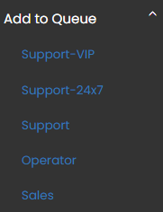
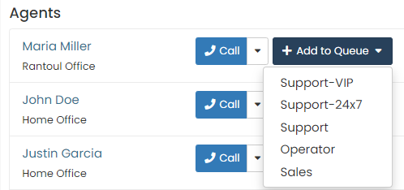
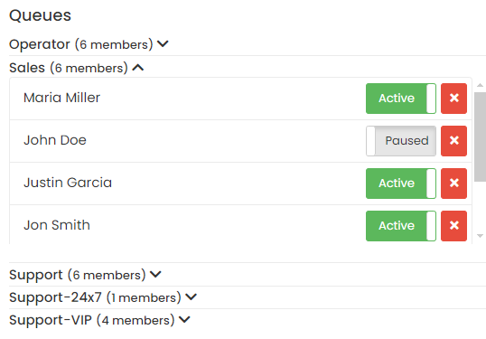
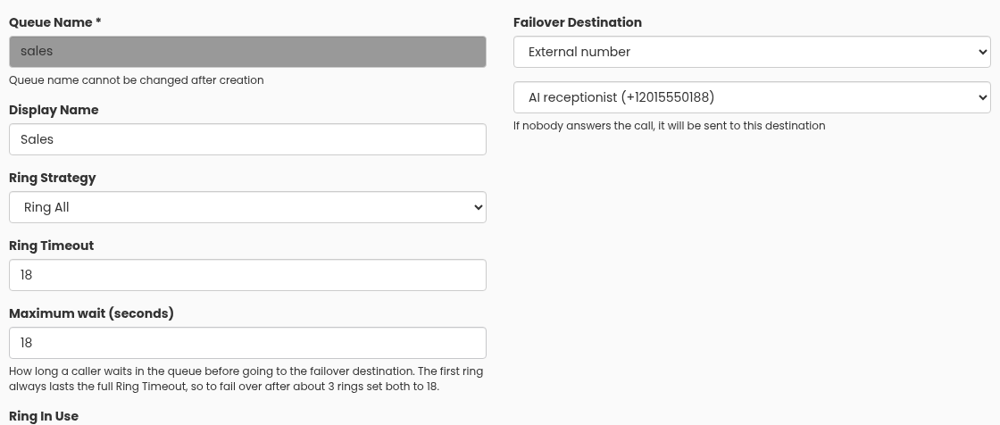
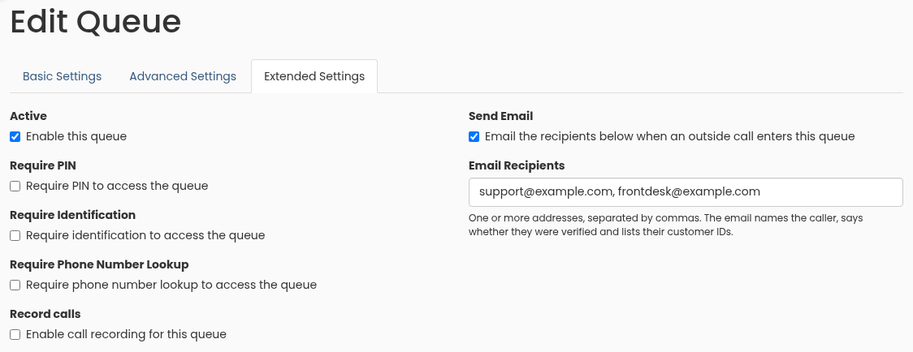

## Queue configuration

To add yourself to one of the existing queues, go to the **Dashboard**: the `Queues` panel lists your queues first; open `Other queues` and click `+ Join` on the queue you want. (The screenshot below shows the earlier menu.)

Additionally, you can add other agents to queues from the `Add to Queue` button, located to the right of the agent name in the agent list.

Note that an Agent can be _Paused_ or _Active_ in a queue, and you can manage it from the list of queues in the dashboard.

## Choose how long callers wait

*Available from SwitchBoard 1.22.0.*

Administrators set up queues under `Settings` -> `Phone System` -> `Queues`. On the queue's **Basic Settings** tab:

- **Ring Timeout** is how long each ring of the queue's agents lasts.
- **Maximum wait (seconds)** is how long a caller waits in the queue before the **Failover Destination** takes the call. The default is 72 seconds.
- **Failover Destination** is where the call goes when nobody in the queue answers in time, for example a voicemail box, another queue, an [external number](/docs/switchboard/external_numbers/) or an [AI agent](/docs/switchboard/ai_agents/) (when AI agents are switched on).

The first ring always lasts the full Ring Timeout, even when the maximum wait is shorter. To send callers to the failover destination after about three rings, set both Ring Timeout and Maximum wait to 18.

### Send unanswered calls to an outside number

To send calls nobody answers to an outside number, such as an answering service, an AI receptionist or a manager's mobile, first add it as an [external number](/docs/switchboard/external_numbers/). Then, on the queue, set **Failover Destination** to **External number** and pick it from the list.

## Hold music

The queue's **Music on Hold** setting chooses what callers hear while they wait, and while an agent has them on hold afterwards. See [Music on Hold](/docs/switchboard/music_on_hold/) to use your own audio.

## Members who answer on a mobile

*Available from SwitchBoard 1.22.0.*

When a queue rings a member on their mobile, through a remote extension, they hear a short prompt when they pick up and press **1** to accept the call. The call becomes theirs only once they press 1: from then on they show as on a call, and the call record and any transcript are credited to them. If they pick up but don't press 1, and someone else in the queue takes the call, the call is credited to the person who took it.

## Email the team when a call enters a queue

*Available from SwitchBoard 1.21.0. The subject format below is from SwitchBoard 1.22.0.*

A queue can send an email each time an outside call enters it, so the team knows who is waiting even before anyone answers. On the queue's settings, turn on **Send Email** and list the addresses under **Email Recipients**, separated by commas.

The email names the caller from your Contacts, says whether they were verified and lists their customer IDs. Its subject tells the cases apart, so mail rules and ticketing tools can sort the emails. For a queue named Support:

| Caller | Subject |
|---|---|
| One contact has the number | Incoming Support Call from Ana Pin - A5001 |
| One contact, with no customer ID | Incoming Support Call from Ana Pin |
| Several contacts share the number | Incoming Support Call from (Guess) Ana Pin - A5001 - +14155550101 |
| No contact has the number | Incoming Support Call from an Unknown Caller +14155550101 |

(Guess) marks the first of the contacts that share the number. The caller may be any of them.
