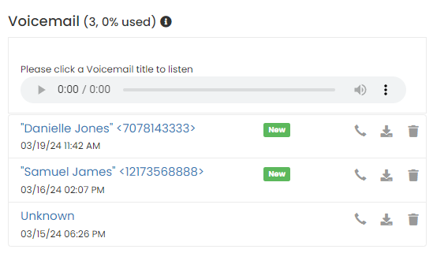

If you don't answer an incoming call, the caller can leave a voice message. You can access messages from your voicemail list in **Switchboard Cloud™** Dashboard.

Select the message you want to listen to by clicking on it, and it will be loaded into the player.

**Asterisk®** internally manages 3 folders to save the audio files of an agent's voice messages. These folders are `INBOX`, `Old` and `Deleted`.

A new message is stored in _INBOX_, an already listened to message goes to _Old_, and a deleted message goes to _Deleted_, so it's possible that your network administrator, accessing the server via SSH, can recover a file that you deleted by mistake.

## Set the time zone of a mailbox

*Available from SwitchBoard 1.23.0.*

When a caller listens to their messages by phone, SwitchBoard announces when each message was received. The mailbox's **Timezone** sets the time zone and the clock style of that announcement.

1. Go to **Voicemail > Mailboxes** and edit the mailbox.
2. Choose a **Timezone**. Each choice shows its time zone and clock style, for example **central24 (America/Chicago, 24-hour)**. The usual choices are central, central24, eastern, european and military.
3. Save the mailbox.

**Use System Default** uses your phone system's standard announcement.

A mailbox set up before 1.23.0 may show its old value followed by *not recognized*. That value doesn't change the announcement: pick one of the listed time zones and save. Saving the form without changing it keeps the old value.
